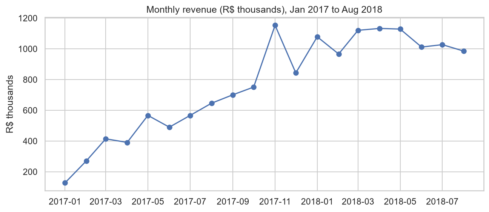
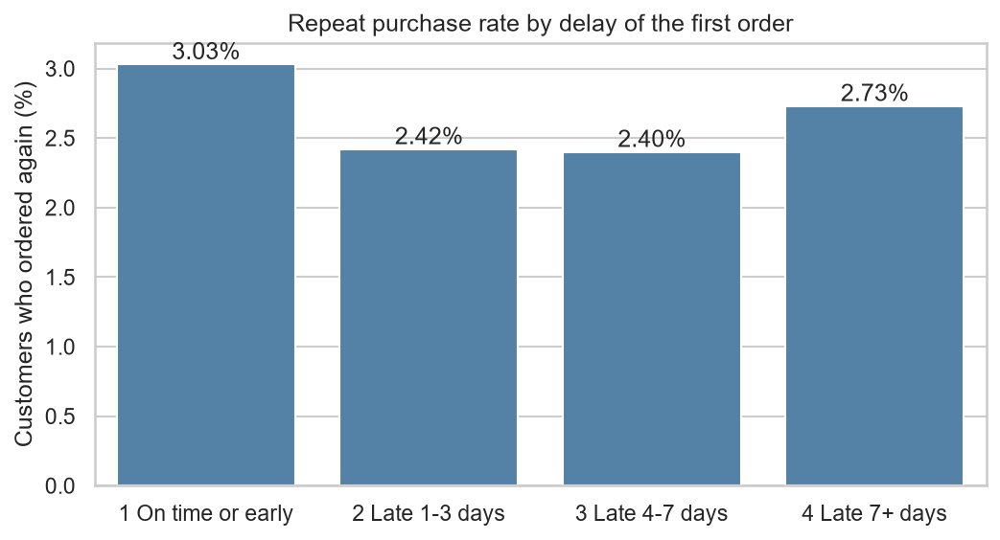
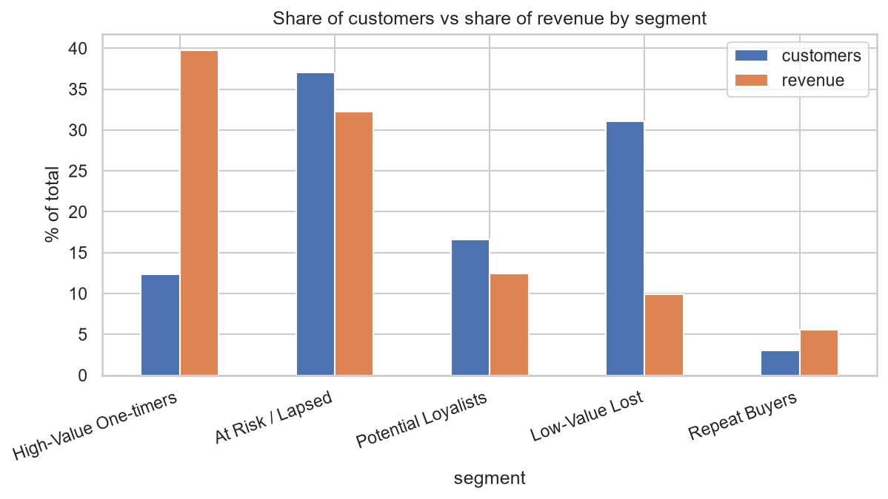
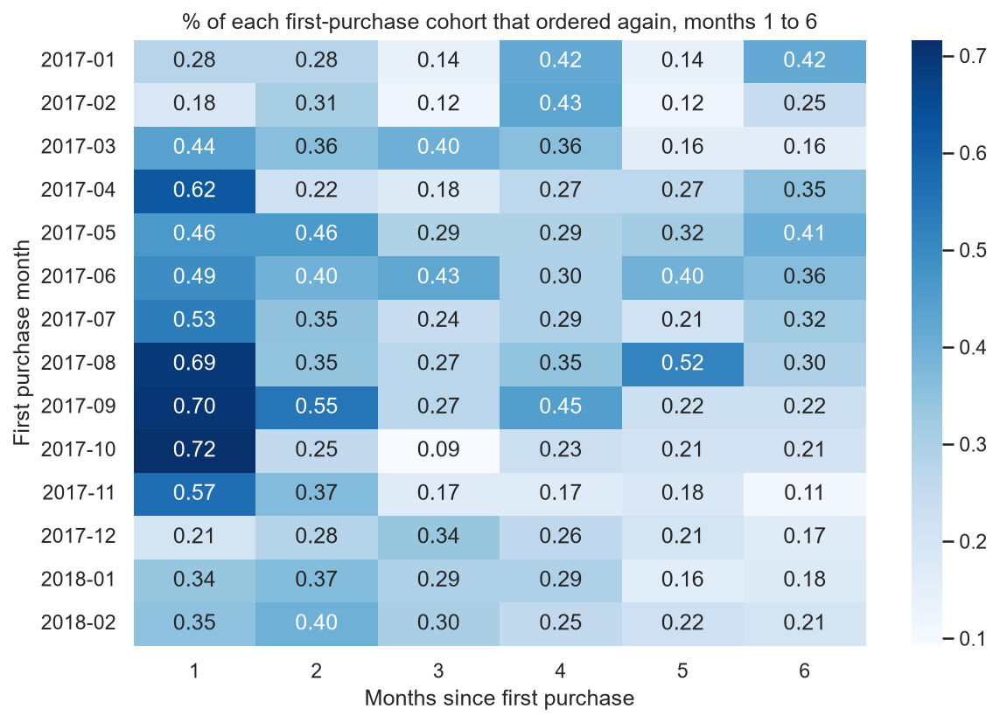
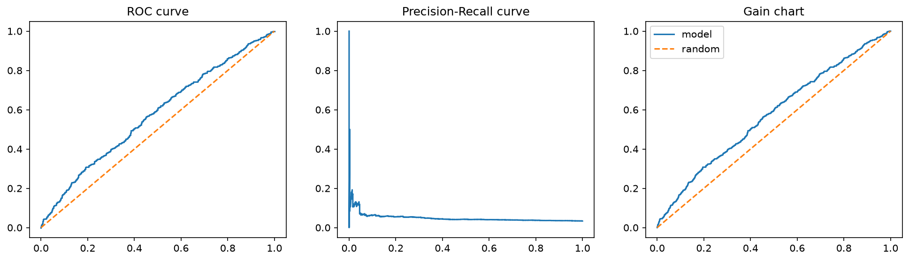
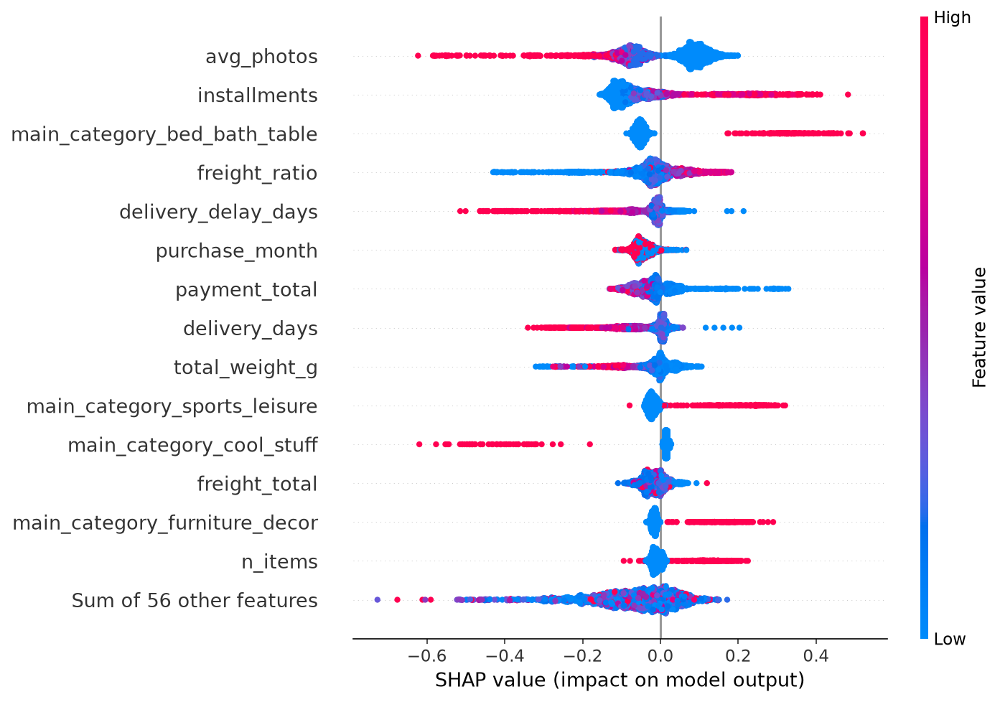
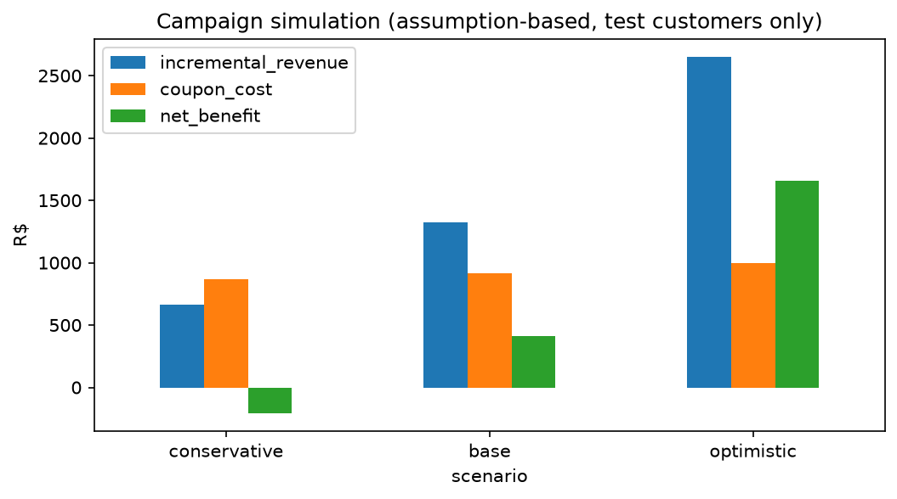

# Olist Customer Retention Analytics

End-to-end retention analysis (SQL, Python, XGBoost, SHAP) on 100K Brazilian e-commerce orders.

**Tech:** PostgreSQL, SQL (CTEs, window functions), Python (pandas, scikit-learn, XGBoost, SHAP, matplotlib, seaborn)

## Key insights

- **Retention is the core problem:** only 3.00% of 93,350 customers (2,801) ever ordered a second time. 97% bought once and never returned.
- **Late delivery destroys satisfaction:** average review is 4.29 stars for on-time orders but 1.70 stars when delivery is 7+ days late. Late customers also reorder slightly less often (about 2.5% vs 3.04% for on-time).
- **Revenue is concentrated:** High-Value One-timers are 12.4% of customers but 39.8% of revenue. Low-Value Lost customers are 31% of customers but only 9.9% of revenue.
- **Repeat behaviour is hard to predict from one order:** the model reaches ROC-AUC 0.576 and PR-AUC 0.050 against a 0.034 base rate. Its top 20% of scores capture 30.8% of repeat buyers (1.5x better than random). XGBoost performed the same as a simple logistic regression baseline (ROC-AUC 0.579).
- **Main model drivers (SHAP):** installments, product photo count, the bed/bath/table category, freight share of order value and delivery delay. More installments and bed/bath/table orders push predictions towards repeat, while long delays push them down.
- **A coupon is roughly break-even:** a R$10 coupon to the top 20% of scored customers nets R$413 in the base case (range -R$208 to R$1,655) on an 11,181-customer test group, so it needs an A/B test before rollout.

## Business problem

Olist is a Brazilian online marketplace. Only 3% of its customers ever place a second order, so almost all acquisition spend buys a single sale. This project asks three questions: who are the customers, what is linked to repeat purchases, and can the first order predict who will come back? It ends with a cost-benefit estimate for a retention coupon.

## Dataset and schema

Public dataset: [Brazilian E-Commerce Public Dataset by Olist](https://www.kaggle.com/datasets/olistbr/brazilian-ecommerce) on Kaggle. It has 9 tables covering roughly 100K orders from 2016 to 2018, loaded into PostgreSQL:

`customers`, `orders`, `order_items`, `order_payments`, `order_reviews`, `products`, `sellers`, `geolocation`, `category_translation`

**Key data gotcha:** `customer_id` is created per order, so it hides repeat buyers. The real person is `customer_unique_id`, and every customer count in this project uses it.

## Pipeline

```
Kaggle CSVs -> PostgreSQL -> 4 cleaning views -> 18 SQL business queries
            -> Python EDA -> RFM + K-Means segments -> first-order features
            -> baseline + XGBoost model -> SHAP -> campaign impact simulation -> final charts
```

## Methodology

**SQL cleaning rules (views in `sql/03_clean_views.sql`)**
- Keep only `delivered` orders with a delivery date.
- Payments are summed to one row per order; only the latest review per order is kept.
- Categories are translated to English; missing categories become `unknown`.
- `delivery_delay_days` = delivered date minus estimated date (positive = late).
- Revenue means what the customer paid in total (items + freight).

**Segmentation:** RFM (recency, frequency, monetary), log-transformed and standardised, then K-Means with k = 5, chosen for interpretable business segments after checking elbow and silhouette plots (`reports/figures/kmeans_k_choice.png`).

**Churn model**
- **Target:** the customer places a second order within 180 days of the first (`repeat_180d`).
- **Features:** built only from the first order (delivery, review, payment, freight, product and timing features).
- **Leakage controls:** no information from later orders; RFM frequency is not a feature; customers without a full 180-day window are excluded from training.
- **Split:** by time, earliest customers for training and the latest 20% for testing (35,779 fit, 8,945 calibration, 11,181 test).
- **Imbalance:** only about 3% of customers repeat, so I used class weights and `scale_pos_weight`, tuned with 15-iteration randomised search on average precision, and judged the model by PR-AUC and lift, not accuracy.
- **Calibration and explanation:** isotonic calibration for realistic probabilities; SHAP for feature effects.

**Impact simulation:** top 20% of test customers by predicted repeat probability receive a R$10 coupon, with assumed uplifts of 5%, 10% and 20% on their repeat probability. Average order value R$159.85. The uplift values are assumptions, not measurements.

## Results

**Repeat rate and reviews by delay of the first order**

| First order delivery | Customers | Repeat rate | Avg review |
|---|---|---|---|
| On time or early | 86,995 | 3.04% | 4.29 |
| Late 1-3 days | 1,820 | 2.36% | 3.29 |
| Late 4-7 days | 1,750 | 2.46% | 2.10 |
| Late 7+ days | 2,785 | 2.66% | 1.70 |

**Customer segments**

| Segment | Customers | Share of customers | Share of revenue | Avg recency (days) | Avg spend (R$) |
|---|---|---|---|---|---|
| High-Value One-timers | 11,547 | 12.4% | 39.8% | 242 | 531 |
| At Risk / Lapsed | 34,536 | 37.0% | 32.3% | 291 | 144 |
| Potential Loyalists | 15,476 | 16.6% | 12.4% | 41 | 124 |
| Low-Value Lost | 28,990 | 31.1% | 9.9% | 280 | 53 |
| Repeat Buyers | 2,801 | 3.0% | 5.6% | 220 | 309 |

**Model comparison (test set, base rate 0.034)**

| Metric | Logistic regression | XGBoost |
|---|---|---|
| ROC-AUC | 0.579 | 0.576 |
| PR-AUC | 0.050 | 0.050 |
| Precision in top 20% | 0.053 | 0.052 |
| Repeaters captured in top 20% | 31.3% | 30.8% |
| Lift in top 20% | 1.57x | 1.54x |

Both models are about 1.5x better than random, and XGBoost added nothing over logistic regression. A single order carries little signal about who returns.

**Campaign simulation (R$10 coupon, top 20% of 11,181 test customers = 2,236 targeted)**

| Scenario | Assumed uplift | Incremental orders | Incremental revenue (R$) | Coupon cost (R$) | Net benefit (R$) |
|---|---|---|---|---|---|
| Conservative | 5% | 4.1 | 663 | 870 | -208 |
| Base | 10% | 8.3 | 1,325 | 912 | 413 |
| Optimistic | 20% | 16.6 | 2,650 | 995 | 1,655 |

## Recommendations

1. **Reduce late deliveries**, starting with the states with the highest late rates (Alagoas 21.4%, Maranhao 17.4%, Sergipe 15.2%) and the sellers that deliver 20% or more of their orders late. This protects review scores (4.29 vs 1.70 stars) and gives a small retention benefit.
2. **A/B test a second-purchase coupon** on the top-scored first-time buyers before any rollout. The base case is only slightly profitable and the conservative case loses money.
3. **Target High-Value One-timers for win-back offers** (12% of customers, 40% of revenue) and avoid spending on Low-Value Lost customers (31% of customers, 10% of revenue).

## Key charts

**Monthly revenue**



**Repeat rate by delay of the first order:** on-time first orders repeat at 3.04% versus 2.36% to 2.66% for late ones.



**Customer segments:** High-Value One-timers are about 12% of customers but about 40% of revenue.



**Cohort retention:** in any single month after the first purchase, well under 1% of a cohort orders again.



**Model gain chart:** the top 20% of scores capture about 31% of repeat buyers.



**SHAP summary:** installments, photo count, the bed/bath/table category, freight share and delivery delay are the top drivers.



**Campaign scenarios (assumption-based)**



All 18 SQL query results are saved as screenshots in `reports/figures/Q1.png` to `Q18.png`.

## Project structure

```
olist-retention-analytics/
├── README.md
├── requirements.txt
├── sql/            01_schema, 02_load_data, 03_clean_views, 04_business_queries
├── src/            db, load_data, cleaning, rfm, features, model, impact
├── notebooks/      01 EDA, 02 RFM, 03 features, 04 model + SHAP, 05 impact, 06 final charts
└── reports/figures/
```

## How to run

1. Install Python 3.12 and PostgreSQL, and create a database named `olist`.
2. Create and activate a virtual environment (`python -m venv venv`), then run `pip install -r requirements.txt`.
3. Download the Kaggle CSVs into `data/raw/`, and create a `.env` file with `DB_USER`, `DB_PASSWORD`, `DB_HOST`, `DB_PORT` and `DB_NAME`.
4. Run `sql/01_schema.sql` in PostgreSQL, then `python -m src.load_data`, then `sql/02_load_data.sql`, `sql/03_clean_views.sql` and `sql/04_business_queries.sql`.
5. Run notebooks 01 to 06 in order. Processed CSV files are created in `data/processed/` and are not committed to the repository.

## Limitations and future work

- Churn is defined as no second order within 180 days, which is a simplification.
- The model uses only one order of information and is weak (ROC-AUC 0.576); XGBoost did not beat logistic regression. Behavioural data such as browsing, marketing contact and price changes would likely help.
- The data covers only two years and has no marketing, price or competitor information.
- Review score and delivery features are known only after the order, so the model suits post-delivery campaigns.
- A high repeat probability does not prove a coupon changes behaviour (propensity is not uplift). The coupon uplift values are assumptions, so an A/B test is needed.

